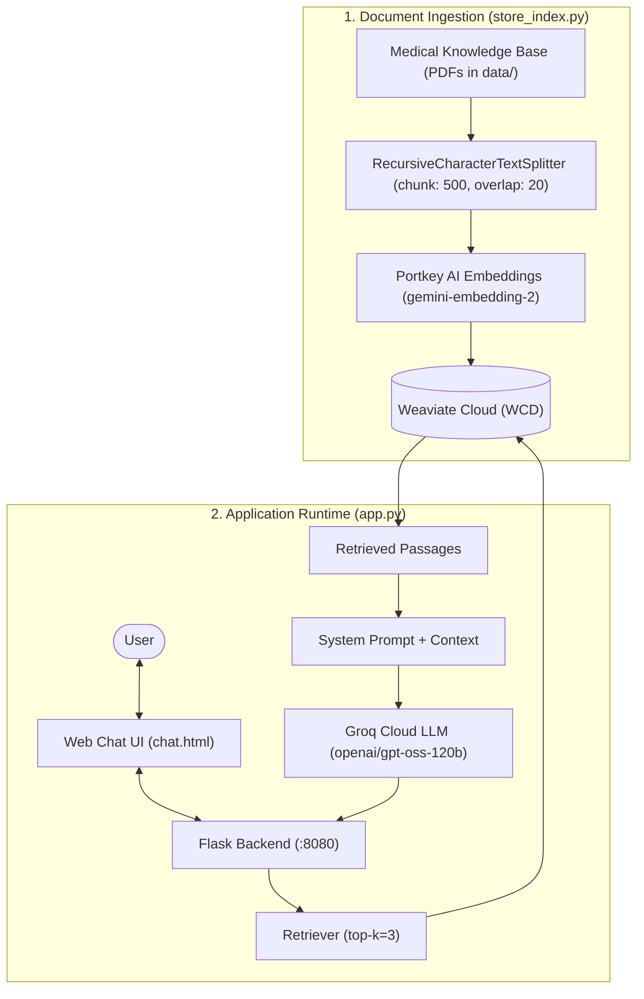

# 🩺 MediRAG: Context-Grounded Medical Chatbot

[](https://www.python.org/)
[](https://flask.palletsprojects.com/)
[](https://www.langchain.com/)
[](https://weaviate.io/)
[](https://groq.com/)

A context-grounded **Medical Q&A Assistant** powered by **Retrieval-Augmented Generation (RAG)**. Instead of relying on open-ended LLM guessing, this system retrieves verified medical excerpts from reference literature and generates accurate, hallucination-resistant answers with low-latency inference on Groq LPUs.

---

## 📌 Architecture Overview



---

## 🚀 Key Features

- **Context-Grounded Answers (RAG)**: Eliminates hallucinations by restricting answers strictly to verified medical reference texts.
- **Fast LPU Inference**: Powered by **Groq** for high token-per-second conversational response times.
- **Vector Search with Weaviate Cloud**: Scalable vector search using dense semantic embeddings generated via Portkey AI Gateway.
- **Interactive Chat Interface**: Clean web interface for real-time medical question answering.

---

## 🛠️ Tech Stack

| Layer | Technology |
| :--- | :--- |
| **Backend Framework** | [Flask](https://flask.palletsprojects.com/) |
| **LLM Orchestration** | [LangChain](https://www.langchain.com/) |
| **LLM Provider** | [Groq](https://groq.com/) (`openai/gpt-oss-120b`) |
| **Embedding Model** | Portkey AI Gateway (`gemini-embedding-2`) |
| **Vector Database** | [Weaviate Cloud (WCD)](https://weaviate.io/) |

---

## 📂 Project Structure

```
.
├── data/
│   └── Medical_book.pdf      # Domain medical reference document
├── src/
│   ├── __init__.py
│   ├── helper.py             # PDF extraction, chunking & embedding helpers
│   └── prompt.py             # Medical assistant system prompt
├── static/
│   └── style.css             # Chat UI stylesheet
├── templates/
│   └── chat.html             # Responsive chat interface
├── .env.example              # Example environment variables
├── app.py                    # Flask server & RAG chain entry point
├── store_index.py            # Vector ingestion script for Weaviate
├── requirements.txt          # Python dependencies
├── setup.py                  # Package installation setup
└── template.sh               # Project structure template script
```

---

## ⚡ Getting Started (Local Setup)

### 1. Prerequisites
- Python 3.10+
- A [Weaviate Cloud (WCD)](https://console.weaviate.cloud/) account, free cluster, and API key
- A [Groq](https://console.groq.com/) account and API key

### 2. Clone and Setup Environment

```bash
git clone https://github.com/Jethva-Parthiv/MediRAG_AI.git
cd MediRAG_AI

# Create and activate virtual environment
python -m venv .venv
source .venv/bin/activate       # On Windows: .venv\Scripts\activate

# Install dependencies
pip install -r requirements.txt
```

### 3. Configure Secrets

Copy the example environment file and fill in your keys:

```bash
cp .env.example .env
```

Inside `.env`:
```env
WEAVIATE_URL=https://your-cluster-url.weaviate.cloud
WEAVIATE_API_KEY=your_weaviate_api_key_here
GROQ_API_KEY=your_groq_api_key_here
```

### 4. Build the Weaviate Vector Index

Ingest the reference medical data into your Weaviate Cloud collection:

```bash
python store_index.py
```

### 5. Run the Application

```bash
python app.py
```

Open your browser and navigate to `http://localhost:8080`.

---

## 🗺️ Roadmap
- [ ] Add conversation memory for multi-turn dialogues
- [ ] Collapsible citation sources for retrieved passages
- [ ] Containerization with Docker
- [ ] Automated CI/CD pipeline on AWS (ECR + EC2)

---

## ⚠️ Medical Disclaimer

*This application is an AI research and educational demonstration. It is not intended to provide medical diagnoses, treatment plans, or clinical advice. Always consult a licensed healthcare professional for medical concerns.*

---

## 📄 License

This project is licensed under the Apache 2.0 License - see the [LICENSE](LICENSE) file for details.
